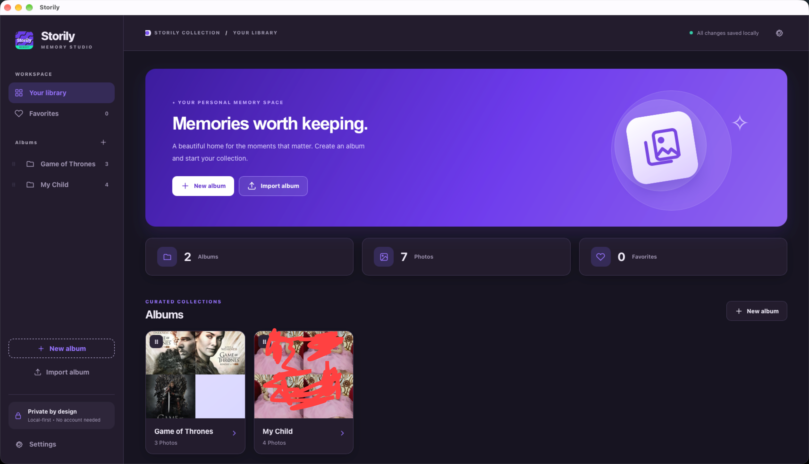
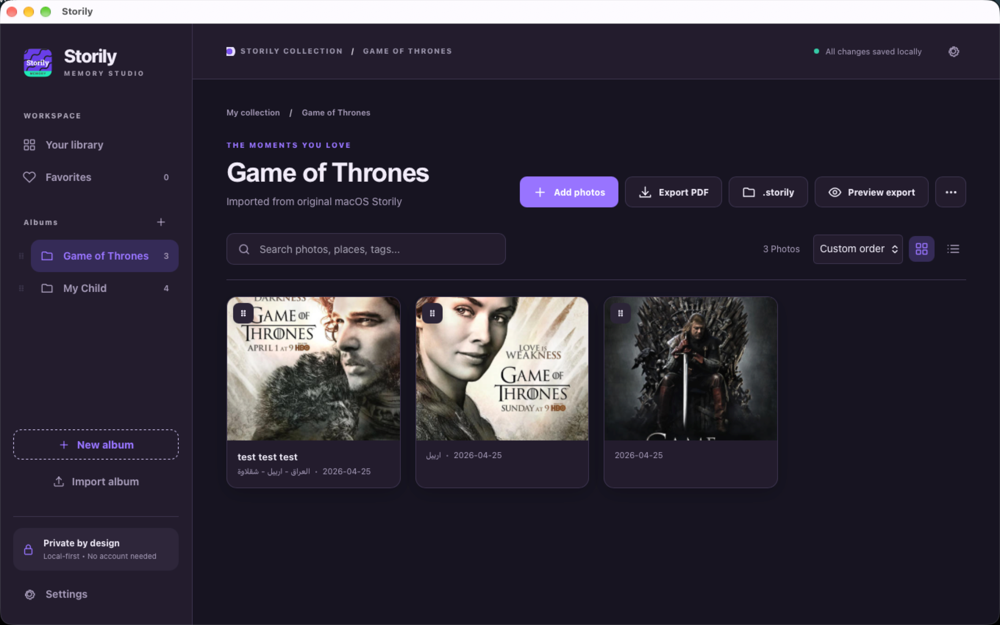
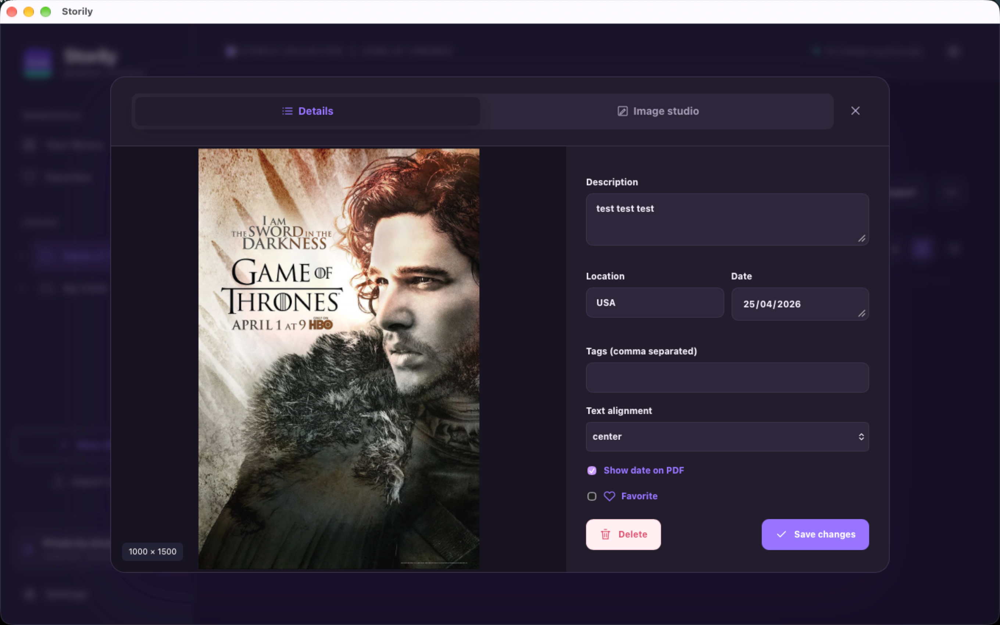
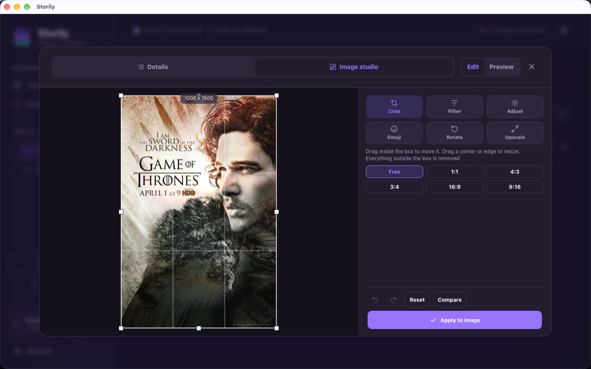
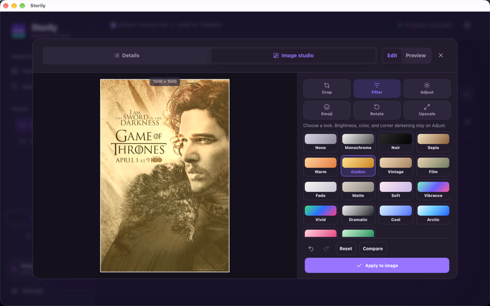
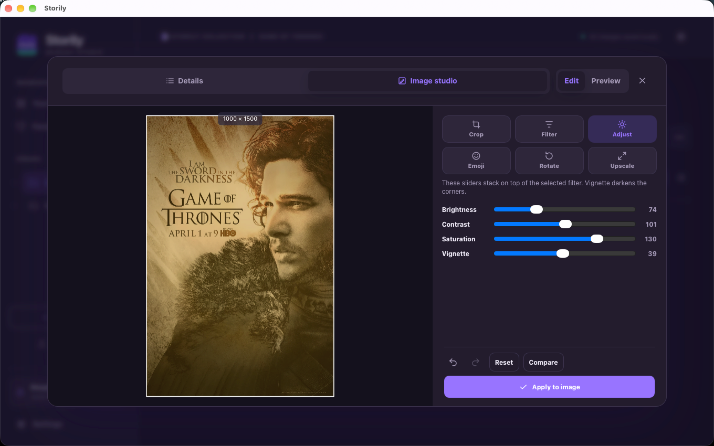
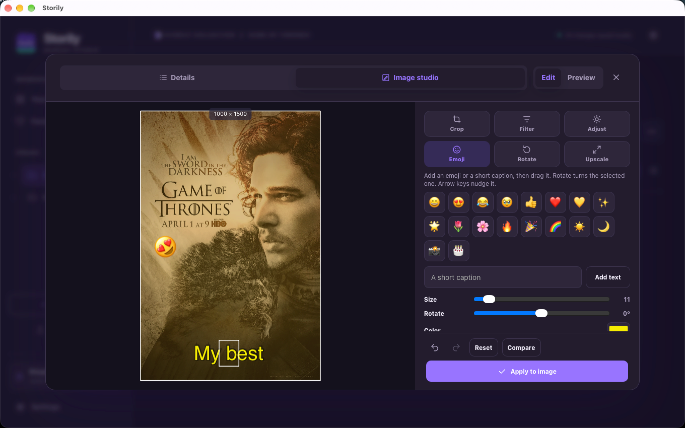
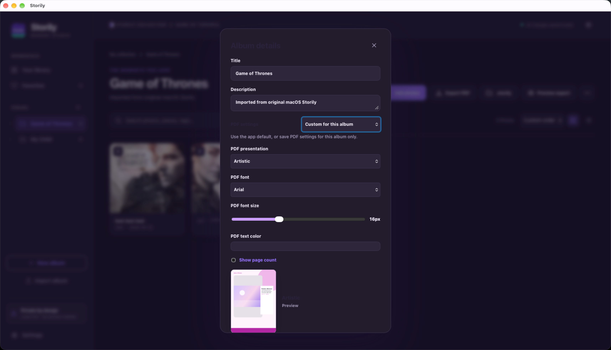
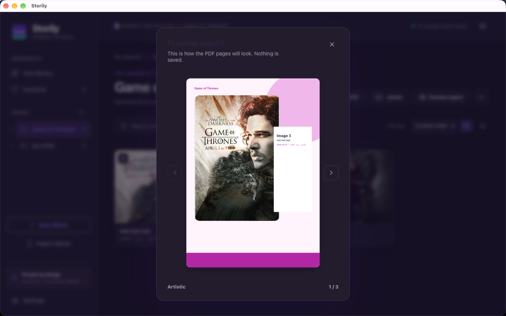

# Storily CrossPlatform

<div align="center">
  
</div>

**An offline-first image archive for Windows 10+, macOS (Intel / Apple Silicon), Linux, Android, iPhone and iPad.**

## Screenshot










> **Status: substantial source-code port / CI-ready starter, not a tested production release.**
> The project has not been compiled on all six operating-system targets. Its first Actions run is the integration test. See `docs/TESTING.md` before publishing binaries.

The project is a new implementation inspired by the MIT-licensed [original SwiftUI Storily](https://github.com/waadmawlood/macos-storily-app). It has its own data storage and cross-platform UI rather than copying Apple-only Swift code. Core: Rust + Tauri 2. Frontend: dependency-light Vite + plain JavaScript + CSS. This avoids an expensive framework at the cost of a smaller, imperative UI codebase.

## Implemented in source

- Native Tauri window with layouts for desktop, tablet, and mobile; English and Arabic with RTL.
- Local album CRUD, photo import (including drag-and-drop desktop), photo metadata, favorites, search and sorting.
- Rust-side validation, image thumbnails, and original image storage under OS app-data folder; no cloud required.
- Editor for crop ratios, rotation, grayscale / sepia / warm / vibrant filters, and emoji overlay; saves rendered PNG.
- PDF export with A4 pages, five presentation themes, font selection, adjustable font size and color. Arabic PDF labels are rasterized through the canvas so custom system fonts need not be embedded.
- `.storily` v2 self-contained JSON archives, as well as import from the original Swift app's JSON-array `.storily` files (`ImageMetadata` field names, Base64 imageData, Swift reference-date encoding). The album gallery can preview the PDF page style without saving a file.
- App icon automatically sourced from the exact upstream 1024×1024 icon when running `npm run icons` / CI build.
- Two Actions workflows: desktop installers, Android APK/AAB, an **unsigned iOS/iPadOS simulator `.app`**, and an optional signed IPA workflow. Publishing a device-installable `.ipa` needs Apple signing and a developer team.

## Requirements

- Node.js 20.19+ or 22+, Rust stable, platform-specific Tauri prerequisites
- Linux: `libwebkit2gtk-4.1-dev`, GTK dev libs, etc.
- Windows: MSVC Build Tools and WebView2
- macOS / iPhone: Xcode; iOS additionally requires CocoaPods
- Android: Android SDK, Java 17, NDK (example workflow installs NDK r27)

References: <https://v2.tauri.app/start/prerequisites/> and <https://v2.tauri.app/distribute/>.

## Run on desktop

```bash
git clone <YOUR-NEW-STORILY-REPOSITORY-URL>
cd Storily-CrossPlatform
npm install
npm run icons          # downloads exact icon from old project and creates all platform icons
npm run tauri dev
```

Build your OS installer:

```bash
npm run tauri build
```

To run Rust tests:

```bash
cargo test --manifest-path src-tauri/Cargo.toml
```

## Run on Android

```bash
npm install
npm run icons
npm run tauri android init -- --ci
npm run tauri android dev
npm run tauri android build -- --debug --apk --target aarch64 --ci
```

APK: `src-tauri/gen/android/app/build/outputs/apk/...` after the build. Debug APKs can be installed for testing. Release AABs **must be signed** with a dedicated Android keystore before Play Store publication.

## Run on iPhone / iPad (macOS + Xcode)

```bash
npm install
npm run icons
npm run tauri ios init -- --ci
npm run tauri ios dev
npm run tauri ios build -- --target aarch64-sim --ci
```

CI attempts an unsigned iOS **simulator** `.app`; a simulator app is NOT a distributable `.ipa` for a physical phone. To ship to real devices or TestFlight, enroll in Apple Developer Program, set a unique bundle ID, configure an Apple development team and certificates/provisioning, and use `npm run tauri ios build -- --export-method app-store-connect` on macOS. Device signing is intentionally not automated here.

## Signed iOS builds (optional, credentials required)

`.github/workflows/build-ios-device.yml` builds an iPhone/iPad **`.ipa`** using `workflow_dispatch` after setting up your registered `com.waadmawlood.storily` bundle identifier and these GitHub **Actions secrets**:

- `APPLE_DEVELOPMENT_TEAM` — your 10-character Apple Developer team ID.
- `IOS_CERTIFICATE` — Base64-encoded Apple Distribution `.p12` certificate.
- `IOS_CERTIFICATE_PASSWORD` — password of the exported `.p12`.
- `IOS_MOBILE_PROVISION` — Base64-encoded App Store Connect provisioning profile matching the identifier and certificate.

This uses the Tauri `ios build --export-method app-store-connect` flow. A store-ready package still requires correct app registration, entitlements and Apple's validation. Do not add certificates or keys to Git; keep them in repository secrets.

Reference: <https://v2.tauri.app/distribute/sign/ios/>.

## GitHub Actions

Copy the ZIP contents into a **new GitHub repository** and push to `main`. GitHub → Actions:

- **Build Storily desktop installers** (`.github/workflows/build-desktop.yml`) targets Windows 10+ x64 `.exe` and `.msi`, macOS arm64 and Intel `.dmg` plus zipped `.app`, Linux x64 `.deb`, `.rpm`, `.AppImage`.
- **Build Storily mobile** (`.github/workflows/build-mobile.yml`) builds a debug Android arm64 APK, unsigned Android AAB, and iOS/iPadOS unsigned simulator app. **Build signed iPhone and iPad IPA** (`.github/workflows/build-ios-device.yml`) builds a real IPA if Apple secrets are configured. These are test artifacts, not store-ready signed outputs.

Use **Run workflow** or push to `main`. Download packages under each successful workflow run → **Artifacts**. On tag `v*`, a **draft GitHub Release** is created, and the build workflows attempt to attach the installer and test assets to it. Publish only after testing and signing the distributable packages. Concurrent jobs may need a workflow rerun if release uploads conflict.

The CI icon step has `--strict`: it fails if the **actual original** logo cannot be fetched, instead of silently shipping the visually similar bundled placeholder. Running the icon script without `--strict` leaves the placeholder when offline. The `src-tauri/icons/original.png` inside this ZIP is a **placeholder only**; original brand art comes from the original repository at build time.

## Existing `.storily` albums

Click **Import album** and select a `.storily` file from the original Swift app. Original albums were written using `JSONEncoder().encode([ImageMetadata]())`. This port recognizes:

- `imagePath`, `imageData` (base64 Data / usually TIFF), `descriptionText`, `location`, `date` (seconds since 2001-01-01), `showDate`, `style`, `textAlignment`.
- Data embedded in the original album is converted into locally managed files and viewable image formats. External-only `imagePath` without `imageData` is rejected rather than silently losing the photo.
- The original macOS application is unchanged; new imported albums are copies.
- Choose **Preview export** on an album to see the PDF page style, type, and captions. That preview does not write a file. **Export PDF** and **Export .storily** still save a file when you want a copy.

**Compatibility caution:** The legacy reader is based on the inspected model source, not a full end-to-end run with real albums. Always use copies of your old files and test round trips before deleting anything.

## Storage and safety

- Saved at `app_data_dir` (determined by OS / app identifier `com.waadmawlood.storily`). Files: `library.json`, `photos/{uuid}.img`, `thumbs/{uuid}.jpg`.
- The app does not intentionally upload photos anywhere. It has no API endpoints and no cloud sync.
- Each image is limited to 40 MiB; the import bridge batches 10 images. Very large archives may consume substantial RAM because portable export contains embedded Base64 images.
- Photo editing **replaces** the stored image. Export a backup first. Metadata operations are synchronized to disk; exceptionally failed imports might leave unused image files requiring cleanup.
- No biometric lock, encrypted vault, AI upscale model, cloud sync, camera capture, nor background photo library integration in this version.
- Mobile exports use Tauri's native save dialog + filesystem plugin (Android `content://` and iOS file URIs are supported by that plugin); browsers may fall back to Web Share or downloads.

## Configuration and customization

- UI / language: `src/main.js`, `src/style.css`
- Rust commands + on-disk domain objects: `src-tauri/src/lib.rs`
- App identifier, bundle names, window properties: `src-tauri/tauri.conf.json`
- App permissions: `src-tauri/capabilities/`
- Logo download and generation: `scripts/sync_original_icon.py`
- CI: `.github/workflows/`
- Architectural notes: `docs/ARCHITECTURE.md`

The original project's icon and branding are reused by reference; the MIT license notice is included. To distribute under your own app name, update the bundle ID, repository links, and release signing identities.
